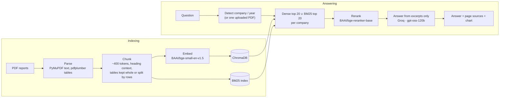

# AskMyReport

Ask plain-English questions about Indian company annual reports, or about any PDF you upload, and get grounded
answers with page-level citations, plus a chart when the question is about a trend or a comparison.

Built as a retrieval-augmented generation (RAG) system over 12 annual reports from 7 companies across 6 sectors
(~3,900 pages, 17K+ chunks): TCS, Infosys, HDFC Bank, Reliance, Hindustan Unilever, Sun Pharma and Maruti Suzuki.

## Results

Every expected answer below was checked against the source text before being used as ground truth.

**Benchmark A: 21 questions** (factual lookups, comparisons, ESG, definitions): `backend/eval/eval_questions.json`

| | Retrieval | Generation | Overall |
|---|---|---|---|
| All 21 questions | **95%** | **90%** | **90%** |

**Benchmark B: 50 complex questions**: `backend/eval/eval_complex.json`. Table reasoning over 10-year summaries,
standalone-vs-consolidated and parent-vs-subsidiary traps, multi-hop questions that never name the company, figures
that must agree across two reports, false premises the model has to correct, and questions the reports can't answer.

| Question type | Questions | Retrieval | Answer |
|---|---|---|---|
| Table reasoning over multi-year tables | 14 | 64% | 64% |
| Disambiguation (standalone vs consolidated, parent vs subsidiary, units) | 10 | 70% | 60% |
| Multi-hop (company not named in the question) | 6 | 50% | 50% |
| Cross-document (figures from two reports must agree) | 4 | 25% | 25% |
| False premise (the model has to correct it) | 6 | 83% | 83% |
| Unanswerable (the model has to say so) | 6 | n/a | **100%** |
| Synthesis (several figures in one answer) | 4 | 100% | 100% |
| **All 50** | 50 | **66%** | **68%** |

15 of the 16 failures are retrieval misses: the chunk holding the answer wasn't in the top 8. Whenever that happened,
the answer didn't contain the expected figure either, so missing evidence wasn't papered over with a made-up number.
The one pure generation miss mixed up a company-only CSR figure with the group figure. The weakest areas,
cross-document and multi-hop questions, point to the next steps: search each report year separately (the way
comparisons already search each company separately), and break a multi-hop question into its parts before
retrieving.

**How retrieval accuracy got from 81% to 95%** (Benchmark A, each step measured on the same questions):

| Change | Retrieval | Retrieval time per question (CPU) |
|---|---|---|
| Dense search (bge-small) + MiniLM cross-encoder, 30 candidates | 81% | ~1.6 s |
| + BM25 keyword search, union of both candidate sets | 76% | not measured |
| + stronger reranker (bge-reranker-base) | 86% | ~12 s |
| + candidate pool tuned from 30+30 to 20+20 | **95%** | ~6.5 s |
| + reranker input capped at 384 tokens | **95%** | ~18% faster than the row above in a side-by-side run |

## How it works



## Engineering decisions worth knowing

- **₹ symbol recovery.** 11 of 12 reports draw ₹ with special fonts that store it as `` ` ``, `H`, `C` or `K`.
  Text is rebuilt span by span and any character from a "Rupee" font is mapped back to ₹.
- **Embedding model swap.** all-MiniLM-L6-v2 reads 256 tokens, which cut off 69% of chunks. bge-small-en-v1.5
  reads 512, which brought truncation down to 0.4%.
- **Heading context in every chunk.** A subsidiary's "GNPA stood at 1.90%" was being reported as HDFC Bank's own
  figure. Prefixing chunks with `[page title > nearest heading]` stopped that misattribution.
- **Exact vector search under filters.** With a company/year filter, Chroma's default HNSW search (`ef_search=100`)
  missed true nearest neighbours and varied between runs. `ef_search=500` matches brute-force results at ~0.2 s.
- **Per-company retrieval for comparisons.** "TCS vs Infosys" used to return 7 Infosys chunks and 1 TCS chunk.
  Each company is now searched and reranked separately, then given equal slots.
- **Hybrid search + reranker tuning**, as in the table above. int8 quantisation of the reranker was tested: it was
  2× faster but dropped retrieval to 76%, so it is not used.
- **Citations that can't be invented.** The LLM cites excerpt numbers; code maps them to company / year / page, so a
  page number in a citation always comes from the index.
- **Uploads stay separate.** A user's PDF goes through the same pipeline into its own Chroma collection with its own
  BM25 index, so library searches never return it and the original file is deleted after indexing.

## Tech stack

**Retrieval & ML:** Sentence-Transformers (bge-small-en-v1.5, bge-reranker-base), ChromaDB, rank-bm25, tiktoken
**LLM:** Groq API (openai/gpt-oss-120b)
**Data:** PyMuPDF, pdfplumber
**API:** FastAPI, SQLite (chat history)
**Web UI:** React + TypeScript (Vite), Recharts, GSAP
**Ops:** Docker, docker compose

## Project structure

```
backend/
  src/
    ingest.py       PDF -> page text + tables (₹ fix)           data/raw_pdfs -> data/parsed
    chunk.py        heading-aware text chunks + table chunks    data/parsed  -> data/chunks
    embed.py        bge-small embeddings                        -> data/chunks/all_embeddings.pkl
    vectorstore.py  load embeddings into ChromaDB               -> vectorstore/
    retrieve.py     company/year detection, dense + BM25, rerank
    generate.py     grounded answer + source mapping (Groq)
    charts.py       chart data for trend / comparison questions
    uploads.py      index a user-uploaded PDF
    api.py          FastAPI: /ask /upload /history /companies /health
  eval/             benchmarks + run_evaluation.py
frontend/           React chat UI
docker-compose.yml
```

## Run it locally

You need Python 3.12+, Node 22 and a free [Groq API key](https://console.groq.com/keys). The reports themselves
aren't in the repo: download them from each company's investor-relations site and save them as
`backend/data/raw_pdfs/<company>/<fiscal-year-end>.pdf` (for example, `tcs/2024.pdf` for FY 2023-24).

```bash
cd backend
python -m venv .venv && source .venv/bin/activate       # Windows: .venv\Scripts\activate
pip install -r requirements.txt
cp .env.example .env                                     # then put your GROQ_API_KEY in .env

python src/ingest.py        # parse PDFs (~6 min for 12 reports)
python src/chunk.py         # chunk
python src/embed.py         # embed (~15 min on CPU)
python src/vectorstore.py   # build the ChromaDB index
uvicorn src.api:app --port 8000
```

```bash
cd frontend
npm install
npm run dev                 # http://localhost:5173
```

## Run with Docker

Build the index once (the pipeline steps above, or the same commands inside the container), then:

```bash
docker compose up --build   # UI: http://localhost:5173   API: http://localhost:8000
```

`backend/data` and `backend/vectorstore` are mounted into the API container, and the Hugging Face models (~1.2 GB)
download into a named volume on the first question. To run a pipeline step inside the container, use
`docker compose run --rm backend python src/ingest.py`.

## API

| Method | Path | What it does |
|---|---|---|
| GET | `/health` | Liveness check |
| GET | `/companies` | Companies and report years in the library (for the filters) |
| POST | `/ask` | `{query, session_id?, company?, year?}` or `{query, session_id?, upload_id}` → `{answer, sources, chart}` |
| POST | `/upload` | Multipart PDF (max 50 MB) → `{upload_id, filename, pages, chunks}` |
| GET | `/history/{session_id}` | The last 50 questions and answers for this browser |

## Evaluate

```bash
cd backend
python eval/run_evaluation.py                          # Benchmark A
python eval/run_evaluation.py eval/eval_complex.json   # Benchmark B
#   --retrieval-only   score retrieval without calling the LLM (no API tokens)
#   --retry-errors     re-ask only questions whose LLM call failed (e.g. rate limits)
```

Each question scores **retrieval** (is a chunk containing every expected fact in the top 8?) and **generation** (does
the answer contain them?) separately, so a failure points at search or at the LLM. Questions the documents can't
answer pass only if the answer says so.

## Limitations

- **CPU latency.** Retrieval takes ~6.5 s for a single company and ~13.5 s for a two-company comparison. Groq
  response time on the free tier varies from about 1 s to 25 s, so a full answer usually takes 10–30 s.
- **Groq free tier.** The limit is 8K tokens/minute and 200K tokens/day, and one answer uses ~4K. A full run of
  Benchmark B takes about a day of quota.
- **Uploads.** Scanned (image-only) PDFs aren't supported, since there is no OCR. A 300-page report takes 1–3
  minutes to index.
- **Scoring.** The benchmarks check that the expected figures appear in the answer, not whether the explanation
  around them is right. Failures are listed so they can be read by hand.
- **Deployment.** The models and BM25 index need ~4 GB RAM, more than most free hosting tiers give. A Docker host
  such as Hugging Face Spaces (CPU, 16 GB) fits.
